# jadhavdurvesh

> Memorable developer positioning.

**Theme:** GitHub · **Style:** Creative · **Agent:** Full-Stack Engineer

## Header
> Editing this section in the inspector.
Hi, I'm **jadhavdurvesh**. This README is tuned for **personal brand** with a GitHub visual system.

  <picture>
    <source media="(prefers-color-scheme: light)" srcset="https://www.gitskins.com/api/section/hero?username=jadhavdurvesh&theme=github-dark&mode=light" />
    
  </picture>

## About Me
Shapes the short profile story and positioning.

  <picture>
    <source media="(prefers-color-scheme: light)" srcset="https://www.gitskins.com/api/section/about?username=jadhavdurvesh&theme=github-dark&mode=light" />
    
  </picture>

## Skills

  

## GitHub Stats
GitSkins stat widgets will use the **GitHub** theme.

  <picture>
    <source media="(prefers-color-scheme: light)" srcset="https://www.gitskins.com/api/section/stats?username=jadhavdurvesh&theme=github-dark&mode=light" />
    
  </picture>

## Projects
Highlights repositories as proof of work.

  <picture>
    <source media="(prefers-color-scheme: light)" srcset="https://www.gitskins.com/api/section/projects?username=jadhavdurvesh&theme=github-dark&mode=light" />
    
  </picture>

## Heatmap
Animated year-long contribution calendar.
## Connect
Contact and social links will appear here.

  <picture>
    <source media="(prefers-color-scheme: light)" srcset="https://www.gitskins.com/api/section/social?username=jadhavdurvesh&theme=github-dark&mode=light" />
    
  </picture>

<!-- Sections: Header, About Me, Skills, GitHub Stats, Projects, Heatmap, Connect -->